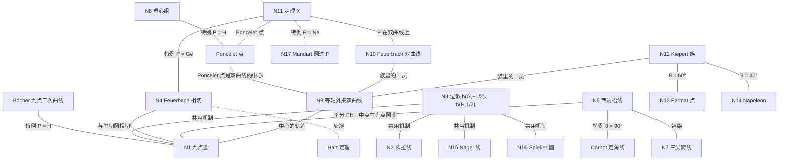

# 九点圆群岛：平面上的定理关系与空缺（第一版）

日期：2026-11-26。

## 0. 思路

已知的定理是一座座「岛」。这份文档只看平面，做三件事：

1. **给每座岛找参数。** 定理里的对象，往往是某个连续族里的一个特殊成员：欧拉线上某个比例的点，Kiepert 族里某个角度的点，任意点 P 取成垂心，圆是二次曲线取成圆。
2. **画岛与岛之间的边。** 边有四种：
   - **特例**：A 是 B 在某个参数值上的特例；
   - **同族**：A 和 B 是同一族里的两个成员；
   - **变换**：对 A 作一次位似、反演等，得到 B（这样的两条定理在网络里算同一个节点）；
   - **共用机制**：A 和 B 靠同一个位似或同一个代数事实成立。
3. **找两种空缺：**
   - **插值空缺**：一个族里只知道几个孤立的成员。参数取中间的值时，定理还成立吗？
   - **外推空缺**：一串定理有规律，比如三个点、四个点、……，下一个会是什么？

《九点圆定理系统》的定理 X 就是一次成功的插值。「F 在内切圆上」「F 在 Mandart 圆上」原本是两座岛，它们是 P 取 Gergonne 点、Nagel 点的特例。这两个点都在 Feuerbach 双曲线上，让 P 沿整条双曲线动，就得到「P 的塞瓦圆都过 F」。

**记号**：✅ 经典已知 · ◇ 本文数值检验成立，新颖性待查 · ✗ 本文数值检验不成立 · ? 还没检验

---

## 1. 岛：节点和它们的参数

| # | 定理 | 自然的参数 | 已知的推广（参数放开以后） |
|---|---|---|---|
| N1 | **九点圆**：三边中点、三个高足、H 到三个顶点连线的中点共圆 | 第四个点 P（P = H 时是圆） | ✅ Bôcher 九点二次曲线：A、B、C、P 六条连线的中点和三个对角点共二次曲线 |
| N2 | **欧拉线**：O、G、N、H 共线 | 直线上的比例 t：X(t) = O + t(H − O)，O、G、N、H 分别是 t = 0、1/3、1/2、1，de Longchamps 点是 t = −1 | ✅ 引擎是位似 h(G, −1/2) |
| N3 | **外接圆与九点圆位似** | 位似比 | ✅ h(G, −1/2) 与 h(H, 1/2) 都把外接圆变成九点圆 |
| N4 | **Feuerbach 定理**：九点圆与内切圆、三个旁切圆相切 | 圆换成二次曲线 | ✅ Hart 定理（反演几何） ✅ 第三轮：Γ 与四条同形的内切、旁切二次曲线都相切 |
| N5 | **西姆松线**：P 在外接圆上 ⇔ P 到三边的垂足共线 | 垂线换成与边成定角 θ 的直线 | ✅ Carnot 定理：对任意 θ，定角线的三个交点共线 ⇔ P 在外接圆上 |
| N6 | **西姆松线平分 PH，中点在九点圆上** | P 在外接圆上的位置 | ✅ 由 h(H, 1/2) 推出（共用 N3 的机制） |
| N7 | **Steiner 三尖瓣线**：西姆松线的包络 | P 绕外接圆一圈 | ? 定角 θ 下的包络（见 4.2） |
| N8 | **垂心组**：A、B、C、H 中任取三点，四个三角形共用一个九点圆 | 第四个点 P | ✅ Poncelet 点：P 任取，四个三角形的九点圆交于一点 |
| N9 | **过 A、B、C 的等轴双曲线**：都过 H，中心都在九点圆上 | 过 O 的一条直线（等轴外接双曲线 = 过 O 的直线的等角共轭像） | ✅ 一个方向参数就扫遍全族：Feuerbach（过 I）、Jerabek（过 O、K）、Kiepert（过 G） |
| N10 | **Feuerbach 双曲线**：过 A、B、C、H、I、Ge、Na，中心是 Feuerbach 点 F | 双曲线上的点 P | ✅ 定理 X：P 的塞瓦圆过 F |
| N11 | **定理 X（一般形式）**：P 的塞瓦圆过 A、B、C、P 的 Poncelet 点 | P 任取 | ✅ 维基「Poncelet point」 |
| N12 | **Kiepert 族**：在三边上向外作底角为 θ 的等腰三角形，顶点与对应顶点的连线共点，记作 K(θ) | 角度 θ | ✅ K(θ) 都在 Kiepert 双曲线上：G（θ = 0）、Napoleon 点（30°）、Vecten 点（45°）、Fermat 点（60°）、H（90°） |
| N13 | **Fermat 点**：三个角都是 120° | N12 中 θ = 60° | ✅ |
| N14 | **Napoleon 定理**：三个外接正三角形的中心构成正三角形 | N12 中 θ = 30° | ? 其他 θ 时这三个顶点构成的三角形有什么性质（见 4.1） |
| N15 | **Nagel 线**：I、G、Sp、Na 共线，IG : GNa = 1 : 2 | 比例 t | ✅ 同样是 h(G, −1/2)：它把 Na 变成 I，把 I 变成 Sp。和欧拉线把 H 变成 O、把 O 变成 N 是同一个位似 |
| N16 | **Spieker 圆**：中点三角形的内切圆 | — | ✅ 内切圆在 h(G, −1/2) 下的像 |
| N17 | **Mandart 圆过 F** | — | ✅ 定理 X 取 P = Na 的特例 |
| N18 | **F 在内切圆上** | — | ✅ 定理 X 取 P = Ge 的特例（这也是 Feuerbach 相切的一半） |

---

## 2. 关系图

实线是不平凡的联系，虚线是只差一次变换。

几点观察：

1. **两个枢纽。** 一是位似 h(G, −1/2)：欧拉线、Nagel 线、九点圆、Spieker 圆都挂在它上面。二是等轴外接双曲线这一族：Feuerbach 双曲线、Kiepert 双曲线、Poncelet 点、定理 X 都通过它连到九点圆。
2. **欧拉线和 Nagel 线是同一个结构。** 同一个位似 h(G, −1/2) 在一边把 (H, O) 变成 (O, N)，在另一边把 (Na, I) 变成 (I, Sp)。九点圆与 Spieker 圆在这个对应下互相对应：前者是中点三角形的外接圆，后者是中点三角形的内切圆。
3. **定理 X 是最大的一座桥。** 它把 Feuerbach 相切（一半）、Mandart 圆、垂心组、Poncelet 点四座岛连成一片。

---

## 3. 本文的数值检验

用 numpy 在 5 个随机三角形上检验，判据是相对误差。

| 编号 | 问题 | 最大误差 | 结论 |
|---|---|---|---|
| T1 | A、B、C、P 的 Poncelet 点在 P 的**塞瓦圆**上 | 3×10⁻¹⁵ | ✅ 定理 X，作为对照组 |
| T2 | 同一个 Poncelet 点也在 P 的**垂足圆**上 | 4×10⁻¹⁴ | ◇ 成立（可能已有记载，待查） |
| T3 | 五个点任取四个，五个 Poncelet 点共圆 | 1.6 | ✗ 不成立 |
| T4 | Carnot 定角线的三个交点共线（P 在外接圆上） | 1×10⁻¹³ | ✅ Carnot 定理，对照组 |
| T5 | 定角线与西姆松线平行 | 0.76 | ✗ 不平行 |
| T6 | 定角线与西姆松线的夹角 | 恒为 π/2 + θ（mod π） | ◇ 定角线就是西姆松线以 P 为中心、作旋转位似（转角固定、比 1/sin θ）的像 |
| T7 | 以 Nagel 点为心、2r 为半径的圆与外接圆内切 | 4×10⁻¹⁶ | ✅ Feuerbach 定理经 h(G, −2) 搬过去的像，是一条「变换边」的例子 |

T6 说明 Carnot 推广其实是西姆松线的平凡变形：每个垂足都绕 P 转同一个角，所以共线自然保留。

---

## 4. 空缺清单

### 4.1 插值空缺

| 编号 | 已知的孤立成员 | 要问的 | 状态 |
|---|---|---|---|
| I1 | P 的塞瓦圆和垂足圆都过 Poncelet 点（T1、T2） | 两者之间有没有一整族圆都过 Poncelet 点？比如过 P 作与三边成定角 θ 的直线，交点所成的圆。按 T6，这个圆是垂足圆绕 P 旋转位似的像，所以一般**不**过 Poncelet 点。需要找别的插值方式 | ? |
| I2 | Kiepert 族中只有 θ = 30°（Napoleon）时三个顶点构成正三角形 | 其他 θ 时这个三角形有什么不变量？它的外接圆、九点圆随 θ 怎样变？ | ? |
| I3 | Feuerbach 双曲线上的点 P，塞瓦圆过 F（定理 X） | 换成 Kiepert 双曲线，塞瓦圆应过其中心 X115，这是定理 X 的另一个特例。问：同一个 P 的**垂足圆**是否也过这个中心？ | ? 由 T2 推测成立 |
| I4 | 欧拉线上 t = 0、1/2 处是外接圆、九点圆 | 圆族 h(H, 1 − t)(外接圆) 中，哪些 t 与内切圆相切？t = 1/2 是 Feuerbach，还有没有别的 t？ | ? 有限个解，可直接计算 |
| I5 | 九点圆与内切圆切于 F，与三个旁切圆切于 Fa、Fb、Fc | 这四个切点是不是某个连续族（比如沿某条曲线移动的圆）的四个特殊位置？ | ? |

### 4.2 外推空缺

| 编号 | 已知的规律 | 要问的 | 状态 |
|---|---|---|---|
| E1 | 三个点有九点圆，四个点有 Poncelet 点（四个九点圆共点） | 五个点任取四个得五个 Poncelet 点，有什么结构？ | ✗ 不共圆（T3）。可以再问：五个 Poncelet 点的某种组合（比如它们的九点圆）是否共点 |
| E2 | 外接圆上的 P 有西姆松线，圆内接四边形有「西姆松线的西姆松线」 | 已知（圆内接 n 边形的西姆松线递归成立） | ✅ |
| E3 | 西姆松线的包络是三尖瓣线 | Carnot 定角 θ 线的包络是什么？由 T6，它是西姆松线绕动点 P 旋转位似，中心在动，所以不一定是三尖瓣线 | ? 值得算 |
| E4 | h(G, −1/2) 把欧拉线结构对应到 Nagel 线结构（第 2 节观察 2） | 欧拉线那边的每一条定理，在 Nagel 线那边有没有对应？比如九点圆 ↔ Spieker 圆，那么「九点圆与内切圆相切」对应什么？ | ? 最有希望的一格 |
| E5 | 每条定理用 h(G, −2)、h(G, −1/2)、h(H, 2) 搬一次，就得到一条新陈述（T7 是一例） | 把这三个位似系统地作用在全部节点上，自动生成所有「变换边」，看哪些像还没有记载 | ? 可以写成程序 |
| E6 | 三角形加一点 P：九点二次曲线（N1）、Poncelet 点（N8）、定理 X（N11） | 三角形加两点 P、Q：有没有同时推广这三条的结构？ | ? |

---

## 5. 下一步

1. **先做 E4。** 欧拉线和 Nagel 线由同一个位似连着，但两边的定理数量很不对称：欧拉线那边有九点圆、Feuerbach、西姆松，Nagel 线那边只有 Spieker 圆。逐条问「它在另一边对应什么」，是一种很具体的插值。
2. **把 E5 写成程序。** 这是第一个可以完全自动化的「边生成器」：输入节点表，输出所有位似像，再查哪些像是已知的。
3. **查新颖性。** T2 和以后成立的每一条，都要先查维基、ETC 和 Gibert 的三次曲线目录。三角形几何被挖得很深，「成立」和「是新的」是两回事。
4. **扩大节点表。** 现在只有九点圆、内切圆两个岛。下一批可以加 Brocard 族、Miquel、Morley 等，看它们和这两个岛之间有没有边。
